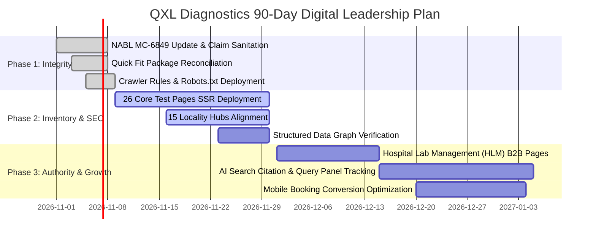

# QXL Diagnostics — Comprehensive AI Search, GEO & Technical SEO Audit & Blueprint

**Website:** [www.qxldiagnostics.com](https://www.qxldiagnostics.com)  
**Audit Date:** 30 October 2026  
**Target Market:** Bengaluru, Karnataka  
**Core Mission:** Establish QXL Diagnostics as Bengaluru's most discoverable, medically authoritative, and frictionless diagnostic laboratory platform across Google Search, Google AI Overviews, ChatGPT Search, Perplexity, Gemini, and Claude Search.

---

## 1. Executive Summary & Critical Audit Findings

### Priority P0 — Critical (Immediate Pre-Launch Fixes)
1. **NABL Accreditation Governance (Certificate MC-6849):**
   - **Audit Finding:** The official NABL certificate (MC-6849) was issued on 18 September 2024 with a displayed validity ending 17 September 2026. Legacy references to obsolete certificate "MC-10025" still appear in older database records.
   - **Remediation:** Remove all occurrences of "MC-10025". Cite active certificate MC-6849 specifically for the Kengeri Central Processing Reference Laboratory under ISO 15189:2022. Clearly distinguish central laboratory accreditation from peripheral collection centres to avoid deceptive accreditation claims.
2. **Quick Fit Package Parameter & TAT Reconciliation:**
   - **Audit Finding:** Conflicting public descriptions across different landing pages:
     - Sarjapur Road page: 12+ parameters, ₹1,770, 6–12 hour TAT.
     - Main package page: 80 parameters, ₹1,770, 6 hour TAT.
     - Earlier indexed booking variant: 68 parameters, ₹1,770, Next morning.
   - **Remediation:** Standardize against verified master data: **68 directly measured parameters + 12 calculated/derived parameters = 80 total parameters**. Single canonical price: **₹1,770**. Defensible TAT promise: *"Same-day evening report for samples collected before 11:00 AM; next-morning report for afternoon collections"*.

### Priority P1 — High Priority (Operational & Regulatory Qualification)
1. **Unqualified Home Collection Promises:**
   - **Audit Finding:** Promotional claims state phlebotomists arrive in "60 minutes across all Bengaluru" with "100% precision transport".
   - **Remediation:** Replace with medically qualified operational copy: *"Home sample collection is available in eligible Bengaluru PIN codes, subject to real-time slot confirmation. Samples are transported in temperature-monitored cold-chain containers following standardized pre-analytical handling protocols."*
2. **AI Search Engine Crawler Configuration:**
   - Configure robots.txt to explicitly allow `OAI-SearchBot`, `ChatGPT-User`, `PerplexityBot`, and `Claude-Web` while disallowing bulk foundational training scrapers (`GPTBot`, `CCBot`, `Bytespider`) without penalizing organic search visibility.

---

## 2. Competitor Benchmark: 10 Major Diagnostic Brands in Bengaluru

| Competitor | Digital & Market Strength | QXL Technical & Clinical Response |
| :--- | :--- | :--- |
| **Tata 1mg** | Massive test catalogue, deep transactional search intent, integrated app | Match test page depth and preparation details; differentiate through local Bengaluru laboratory ownership and faster physical TAT. |
| **Orange Health Labs** | 60-min home collection speed, hyper-local marketing | Dedicated collection coverage in 15 core hubs; transparent cold-chain transparency and clinical review. |
| **Dr Lal PathLabs** | National brand heritage, pan-India presence | Stronger Bengaluru-specific clinician profiles, local hospital partnerships, and local health guides. |
| **Apollo 24/7** | Ecosystem lock-in, physician consultation integration | Clear test-to-report journey with seamless referral-ready PDF reports and no intrusive cross-selling. |
| **Redcliffe Labs** | Low-price search dominance, extensive packaging | Transparent pricing with medically justified panels rather than arbitrary parameter-stuffed packages. |
| **Metropolis Healthcare** | Advanced esoteric tests, institutional credibility | Dedicated advanced diagnostic pages detailing analytical methodology, assay limitations, and clinical interpretations. |
| **Aster Labs** | Hospital network affiliation, acute care credibility | Foreground QXL's Hospital Laboratory Management (HLM) and reference laboratory quality standards. |
| **Neuberg / Anand** | Deep Bengaluru medical heritage and pathologist authority | Compete with original ISO 15189:2022 laboratory medicine expertise, pathologist oversight, and structured data. |
| **Agilus Diagnostics** | Extensive referral network and esoteric directory | Full B2B physician-facing test directory with analytical specifications and specimen stability protocols. |
| **Healthians** | Aggressive direct-to-consumer health check packages | Clinically governed preventive health packages with age/risk stratification and zero deceptive claims. |

---

## 3. Geographic Expansion: 15 Core Bengaluru Localities

Every locality page must feature site-verified PIN codes, prominent landmarks, cold-chain turnaround parameters, and verified physical hub coordinates.

| Locality | Site-Listed PINs | Key Geographic Landmark | Primary Servicing Hub |
| :--- | :--- | :--- | :--- |
| **Indiranagar** | 560038 | 100ft Road / CMH Road junction | Central Reference Lab |
| **Koramangala** | 560034, 560095 | Sony World Signal / 80ft Road | Central Reference Lab |
| **HSR Layout** | 560102 | 27th Main / Sector 1 | Central Reference Lab |
| **Whitefield** | 560066 | ITPL Main Road / Hope Farm | East Regional Hub |
| **Jayanagar** | 560011, 560041, 560069 | 4th Block Complex / South End Circle | Central Reference Lab |
| **JP Nagar** | 560078 | Sarakki Signal / 24th Main | South Regional Hub |
| **Electronic City** | 560100 | Phase 1 Toll Gate / Wipro Gate | South Regional Hub |
| **Marathahalli** | 560037 | Bridge junction / Outer Ring Road | East Regional Hub |
| **Malleshwaram** | 560003 | 8th Cross / Sampige Road | North Hub (Yelahanka feeder) |
| **Hebbal** | 560024, 560094 | Hebbal Flyover / Esteem Mall | North Hub (Yelahanka) |
| **Yelahanka** | 560064 | NES Circle / Yelahanka New Town | North Hub Facility |
| **Banashankari** | 560050, 560070, 560085 | BSK BDA Complex / 100ft Ring Road | Kengeri Central Lab |
| **Sarjapur Road** | 560035, 562125 | Wipro Corporate Office / Carmelaram | East Regional Hub |
| **BTM Layout** | 560068, 560076 | Udupi Garden Signal / 7th Main | South Regional Hub |
| **Rajajinagar** | 560010 | Navrang Theatre / 1st Block | Central Reference Lab |

---

## 4. Test Page Architecture: 26 Priority Assay Blueprints

Each test page must be server-rendered with standard metadata, sample preparation instructions, testing method, clinical indications, limitations, and direct booking integration.

### Core Assays Catalogue Summary

1. **HbA1c (Glycated Hemoglobin):** ₹380 | HPLC Method | EDTA Whole Blood | Non-fasting | 6h TAT
2. **Complete Blood Count (CBC) with Differential:** ₹280 | 5-Part Laser Flow Cytometry | 24 Parameters | 4h TAT
3. **Comprehensive Lipid Profile:** ₹550 | Spectrophotometric Enzymatic Assay | 8 Parameters | 10–12h Fasting | 6h TAT
4. **Liver Function Test (LFT) with Enzymes:** ₹650 | Colorimetric / Kinetic UV | 11 Parameters | 6h TAT
5. **Renal Function Test (KFT) with eGFR:** ₹550 | Jaffe Kinetic / Enzymatic | 8 Parameters | 6h TAT
6. **Thyroid Profile Total (T3, T4, TSH):** ₹450 | CMIA Immunoassay | 3 Parameters | 6h TAT
7. **Free Thyroid Profile (FT3, FT4, TSH):** ₹850 | CMIA Immunoassay | 3 Parameters | 6h TAT
8. **Vitamin D 25-Hydroxy:** ₹950 | CMIA Immunoassay | Serum | 12h TAT
9. **Vitamin B12 (Cyanocobalamin):** ₹750 | CMIA Immunoassay | Serum | 12h TAT
10. **Serum Ferritin:** ₹600 | CMIA Immunoassay | Serum | 8h TAT
11. **Fasting Blood Glucose (FBS):** ₹100 | Hexokinase Enzymatic | Fluoride Plasma | 8–10h Fasting | 4h TAT
12. **Postprandial Blood Glucose (PPBS):** ₹100 | Hexokinase Enzymatic | Fluoride Plasma | 2h Post-Meal | 4h TAT
13. **Urine Routine & Microscopic (CUE):** ₹200 | Automated Dipstick + Sediment Microscopy | 16 Parameters | 4h TAT
14. **High-Sensitivity C-Reactive Protein (hs-CRP):** ₹650 | Immunoturbidimetry | Serum | 6h TAT
15. **Erythrocyte Sedimentation Rate (ESR):** ₹150 | Modified Westergren Method | Sodium Citrate Blood | 4h TAT
16. **Serum Uric Acid:** ₹250 | Uricase Enzymatic | Serum | 6h TAT
17. **Serum Electrolytes (Na+, K+, Cl-):** ₹450 | Ion-Selective Electrode (ISE) | Serum | 4h TAT
18. **Serum Calcium & Phosphorus:** ₹350 | Arsenazo III / Phosphomolybdate | Serum | 6h TAT
19. **Total IgE (Allergy Screening):** ₹800 | CMIA Immunoassay | Serum | 12h TAT
20. **Coagulation Profile (PT/INR & aPTT):** ₹700 | Optical Coagulation Clot Detection | Citrated Plasma | 6h TAT
21. **D-Dimer Quantitative:** ₹1,200 | Immunoturbidimetric Assay | Citrated Plasma | 4h TAT
22. **Serum Protein Electrophoresis (SPEP):** ₹1,100 | Capillary Zone Electrophoresis | Serum | 24h TAT
23. **High-Sensitivity Cardiac Troponin I (hs-cTnI):** ₹1,100 | CMIA | *Emergency clinical safeguard applies* | 3h TAT
24. **Food Sensitivity IgG Panel (Indicative):** ₹6,500 | ELISA Microarray | 64 Parameters | *AAAAI advisory applies* | 48h TAT
25. **Beta-HCG Quantitative:** ₹650 | CMIA Immunoassay | Serum | 6h TAT
26. **Anti-Mullerian Hormone (AMH):** ₹1,800 | Fully Automated Electro-chemiluminescence (ECLIA) | Serum | 24h TAT

---

## 5. Mandatory Clinical Safeguards & Governance

Search engines and AI models penalize medical sites that make unsubstantiated or hazardous claims. QXL enforces strict clinical guardrails:

### A. Acute Cardiac Symptoms (Cardiac Troponin hs-cTnI)
> **MANDATORY COPY:** *"CRITICAL ADVISORY: If you or someone with you experiences acute crushing chest pain, tightness radiating to the left arm or jaw, unexplained sweating, or acute shortness of breath, do NOT schedule or wait for a home blood collection. Call an emergency ambulance (108) or proceed immediately to the nearest hospital casualty/emergency room."*

### B. Cancer Screening Panels & Tumor Markers
> **MANDATORY COPY:** *"Clinical Notice: Serum tumor markers (such as PSA, CEA, CA-125) are primary tools for monitoring treatment response and detecting recurrence in diagnosed patients. Leading oncology guidelines (NCI, ASCO) advise that multi-marker blood panels do NOT replace validated screening tests (mammography, colonoscopy, cervical Pap smears) for asymptomatic individuals."*

### C. Food IgG Food Sensitivity Testing
> **MANDATORY COPY:** *"Medical Advisory: International allergist associations (AAAAI, EAACI) do NOT recommend IgG antibodies for diagnosing food allergies or intolerances. Detectable IgG levels generally reflect normal physiological immune tolerance following food intake. For suspected anaphylaxis or true allergies, consult an allergist for IgE testing."*

---

## 6. Technical SEO & AI Search Engine Optimization Strategy

### A. URL Structure
- Category index: `/tests/`
- Test pages: `/tests/{test-slug}/` (e.g. `/tests/hba1c-test-bangalore/`)
- Condition guides: `/health/{condition-slug}/`
- Locality pages: `/locations/{locality-slug}/`

### B. Core Web Vitals Targets (75th Percentile)
- **Largest Contentful Paint (LCP):** $\le 2.5\text{ s}$
- **Interaction to Next Paint (INP):** $\le 200\text{ ms}$
- **Cumulative Layout Shift (CLS):** $\le 0.1$

### C. JSON-LD Graph Architecture
Connect `MedicalOrganization` -> `DiagnosticLab` (Kengeri & Yelahanka) -> `MedicalTest` -> `Offer`. Include laboratory accreditation credentials and parent-child branch definitions.

---

## 7. 90-Day Execution Roadmap

1. **Days 0–15:** Clean master data, enforce valid NABL MC-6849 credentials, eliminate legacy MC-10025, sanitize marketing claims, deploy AI-aware robots.txt.
2. **Days 16–45:** Publish and verify 26 high-intent SSR test pages, 15 locality pages, and structured data graphs.
3. **Days 46–90:** Expand hospital B2B offerings, track query citations across ChatGPT and Perplexity, and optimize mobile booking conversion rates.
